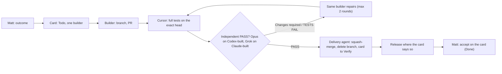

# <PROJECT NAME>

Agents that change this repo follow this file. Linear project "<LINEAR PROJECT>" is the work board and the single record: each Linear issue ("card") owns its status and evidence. GitHub holds code, PRs and review verdicts. GitHub Actions is off; nothing runs on GitHub's machines, and the delivery loop has no scheduled jobs. Product decisions live in docs/decisions.md. The delivery flow is drawn in docs/delivery/workflow.md. Read those when the task touches them; do not restate them elsewhere.

## What this is

<One paragraph: what the product is, who uses it, what is out of scope.>

Stack: <languages, frameworks, runtime versions, database>.

## Project rules

<Safety and data rules specific to this project. Delete this section if there are none.>

- No personal names, amounts, addresses or dates in source or fixtures.

## Delivery

Matt has two gates: **Start**, where he sets the outcome, acceptance examples and boundaries, and **Finish**, where he accepts the running result on the card. Everything between them is automatic and never waits on a person. **The merge rule is one sentence: a PR merges when its exact head has TESTS PASS and an independent review PASS for that SHA, and nothing later contradicts them.** Every PR, whatever its risk, gets TESTS PASS from Cursor's test run (`test: cursor`, Composer 2.5) and an independent PASS for that SHA from the other model family: Claude Opus on Codex-built PRs (`review: claude-opus`), Grok 4.7 High on Claude-built PRs (`review: grok`).

- **Roles.** Claude (Opus) is delivery owner: writes the card, chooses the builder, owns findings and board state. Builders, by card: Sol 6.1 (Codex CLI on Matt's PC, started by the delivery agent) for core logic, data imports, calculations and migrations; Claude Sonnet (Claude Code on Matt's plan, never an API key) for low-risk cards: docs, copy, layout, tests, small fixes; Claude Opus for wide refactors; GPT-6 Luna for mechanical isolated fixes; Cursor (Grok 4.7, Fast off) only for a specific reason. Architecture and specs: Opus first, Astra when the Claude window is past 85%. Builders never merge. The delivery agent merges, releases and keeps the board and repo tidy.
- **Risk.** Classify by effect, not file count. High risk: calculations or their meaning, stored data writes, schema or migrations, imports, auth, secrets, external exposure, dependencies or paid services. Risk decides what Matt must settle before work starts and how deep the review looks, not whether there is one. Low risk (copy, layout, accessibility, docs, tests, fixes restoring an approved contract) proceeds under standing authority. Record the reason in the PR. Mixed changes use the highest risk.
- **Standing authority.** Within an approved outcome, agents implement, fix and validate low-risk changes without asking. New product scope, spending, real-data migration, bulk data changes, destructive operations and cutover need Matt's explicit decision on the card before the work starts, never during it.
- **States.** Backlog (parked), Todo (Ready: approved scope, acceptance examples, dependencies clear, exactly one builder, sized to one builder session: one PR of roughly 25 files, under about 15 minutes for Sol; a larger outcome is split before it is Ready), In Progress (building and repairing), In Review (Cursor tests and independent review; the agent merges from here), In Review + `Verify` (merged; awaiting Matt's acceptance), Done (Matt accepted, findings disposed, evidence on the card). `Blocked` names a dependency or decision. Automation moves cards to Verify, never to Done.
- **Card format.** The `**Target branch:** main` line stands on its own line with nothing after the branch name. Codex worker trigger: state Todo + `sol-ready` + exactly one `sol-base:<branch>` label.
- **One card, one branch, one PR.** Branches `claude/<task>`, `codex/<task>` or `cursor/<task>` from current origin/main. The PR links its card. Never force-push a published branch; merge main in instead. Scope changes mid-build go on the same card and branch, or the card is cancelled before the builder starts; never both.
- **Findings** stay on the card and PR with source, impact, owner and disposition: fixed, invalid with evidence, duplicate, or a linked non-blocking follow-up. Critical and major findings block merge. The same builder repairs; after two failed rounds the agent labels the card `Blocked` and hands diagnosis to Astra.

## Review, tests and merge evidence

- Cursor is the test machine. A Cursor cloud run (Composer 2.5) checks out the exact PR head, runs `<TEST COMMAND>`, and posts **TESTS PASS** or **TESTS FAIL** for that full SHA on the PR and the card. Prompt: docs/delivery/cursor-tests-prompt.md.
- PR labels start it: `test: cursor` on every PR. The review label depends on who built it: `review: claude-opus` on Codex-built PRs, `review: grok` on Claude-built PRs. Verdict **PASS** or **Changes required** for the SHA, as a PR review and a card comment. The builder, or the agent on its behalf, adds both labels when the PR opens.
- Independence: no model family reviews its own code; an author never certifies its own work; a reviewer who takes over implementation cannot approve its own additions. Small fixes get a focused re-review, not a restart.
- The delivery agent squash-merges when the exact head has TESTS PASS and a PASS for that SHA, with no later TESTS FAIL or Changes required for it, the PR open, non-draft, same-repository and mergeable, and no `do not merge` label. It mirrors any Linear-only verdict to the PR first. Merge requests pin the SHA. Merging never deploys and never accepts.
- Run focused checks while iterating and the full suite before opening or updating a PR with executable changes. Pure documentation changes need diff, link and consistency checks only. Do not weaken the suite in a routine fix.
- The PR template is the evidence packet. Keep Built, Verified and Running evidence distinct on the card. Record limitations instead of claiming unperformed validation.

## Model selection and cost

Never Fast or Ultrafast on any model, including retries. No model ladder, no duplicate reviews. Judge cost per accepted outcome; never invent billing savings. Never buy credits, enable overages or change subscriptions.

**Platform out.** A platform is out when its provider reports no quota, or at the soft limit: Cursor at 80% of the plan, Codex past 90% of the week with more than a day to reset, a Claude window past 85% (wait if it resets within an hour), or when it cannot start a card (one setup error, or two timeouts). The agent writes the handoff checkpoint on the card (scope link, owner, branch and commit, checks with tested commit, unresolved findings, next action; never credentials) and moves the step to next best:

| Step | Order |
| --- | --- |
| Design, spec, architecture | Claude Opus → Astra → Sol 6.1 High → pause |
| Core-logic build | Sol 6.1 → Claude Sonnet → Grok 4.7 |
| Low-risk build | Claude Sonnet → Sol 6.1 → Grok 4.6 |
| Wide refactor | Claude Opus → Sol 6.1 High |
| Mechanical | Claude Sonnet → Grok 4.6 → GPT-6 Luna |
| Review of Codex-built code | Claude Opus → Grok 4.7 High |
| Review of Claude-built code | Grok 4.7 High → Sol or Astra |
| Test run | Composer 2.5 → Grok 4.7 → pause |

When every option is out, the step pauses with the checkpoint kept; nothing is merged without review. One builder stays active at a time.

## Sessions

- One card, new sessions: each role starts a new session per card. Never resume a session from another card.
- Record at start on the card: role, platform, model, effort, session id, Fast off, branch. Close with: model, compactions, repair rounds, plan usage where shown (else "unavailable").
- After two context compactions or 24 hours, write the checkpoint and continue in a new session.

## End of card

When a card is accepted, parked or handed off, the builder labels it `End of card`; the delivery agent then:

1. Closes every session.
2. Stops temporary services and removes worktrees and test databases.
3. Writes one current-state header on the card (built, reviewed, running, accepted, open findings, next card).
4. Cancels redundant cards and closes superseded PRs with a one-line reason.
5. Appends the row to the Delivery scorecard document in the Linear project.
6. Tells Matt once: outcome, scorecard line, at most one process suggestion.

## Security

Secrets stay in the environment; .env is gitignored. Do not print tokens, database URLs or row payloads. A dependency change needs a reason in the PR.

## Docs

Update docs/decisions.md only when Matt accepts a product rule. Do not add a parallel instruction file. If this file disagrees with the code, fix the file or ask.
