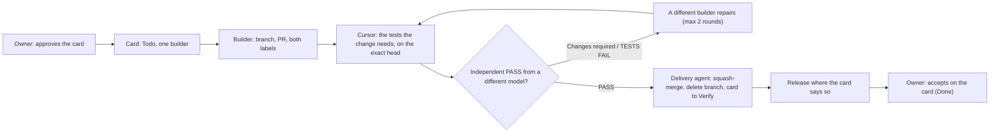

# <PROJECT NAME>

Agents that change this repo follow this file. Linear project "<LINEAR PROJECT>" is the work board and the single record: each Linear issue ("card") owns its status and evidence. GitHub holds code, PRs and review verdicts. GitHub Actions is off; nothing runs on GitHub's machines, and the delivery loop has no scheduled jobs. Product decisions live in docs/decisions.md. The delivery flow is drawn in docs/delivery/workflow.md, and the delivery agent's config is described in docs/delivery/README.md. Read those when the task touches them; do not restate them elsewhere.

## What this is

<One paragraph: what the product is, who uses it, what is out of scope.>

Stack: <languages, frameworks, runtime versions, database>.

## Project rules

<Safety and data rules specific to this project. Delete this section if there are none.>

- No personal names, amounts, addresses or dates in source or fixtures.

## Delivery

The owner has two gates: **Start**, where they approve a card that the delivery owner has written (outcome, acceptance examples, boundaries; a yes in chat or moving the card to Todo is the approval), and **Finish**, where they accept the running result on the card. Everything between them is automatic and never waits on a person. **The merge rule is one sentence: a PR merges when its exact head has TESTS PASS and an independent review PASS for that SHA, and nothing later contradicts them.** Every PR, whatever its risk, gets TESTS PASS from the Cursor test run (`test: cursor`) and an independent PASS for that SHA from a different model from the builder, any vendor, in a fresh session.

- **Roles.** Claude (Opus) is delivery owner: writes the card, chooses the builder, owns findings and board state. Builders, reviewers and the test runner are named in the delivery agent's config (the builder pool in docs/delivery/README.md), never in code, so adding, swapping or retiring a model is a config change only. The current line-up is in [Model selection and cost](#model-selection-and-cost). Builders never merge. The delivery agent merges, releases and keeps the board and repo tidy.
- **Model-agnostic.** Rules name roles, lanes and families, not models. Anywhere a builder, tester or reviewer is shown (cards, start notes, PR comments, logs, dashboards), name the model and effort that actually ran, read from the session or receipt. Fall back to the neutral lane name only when the model is unknown. Never hard-code a model name into a display label.
- **Risk.** Classify by effect, not file count. High risk: calculations or their meaning, stored data writes, schema or migrations, imports, auth, secrets, external exposure, dependencies or paid services. Risk decides what the owner must settle before work starts and how deep the review looks, not whether there is one. Low risk (copy, layout, accessibility, docs, tests, fixes restoring an approved contract) proceeds under standing authority. Record the reason in the PR. Mixed changes use the highest risk.
- **Standing authority.** Within an approved outcome, agents implement, fix and validate low-risk changes without asking. New product scope, spending, real-data migration, bulk data changes, destructive operations and cutover need the owner's explicit decision on the card before the work starts, never during it.
- **States.** Backlog (parked), Todo (Ready: approved scope, acceptance examples, the acceptance test and the target screen width, dependencies clear, exactly one builder, sized to one builder session: one PR of roughly 25 files; a larger outcome is split before it is Ready), In Progress (building and repairing), In Review (Cursor tests and independent review; the agent merges from here), In Review + `Verify` (merged; awaiting the owner's acceptance), Done (owner accepted, findings disposed, evidence on the card). `Blocked` names a dependency or decision. Automation moves cards to Verify, never to Done. No card is assigned to, or waits on, the owner; anything that needs them is raised with them in chat.
- **Card format.** The `**Target branch:** main` line stands on its own line with nothing after the branch name. Each card names its Builder and Reviewer, and a Scope list of the repository paths it touches, so the agent can run cards in parallel when their paths don't overlap; a card that names no paths never runs beside another build. Lane trigger: state Todo + the lane's ready label (from the config) + exactly one base label.
- **UI cards** name the approved design reference (<DESIGN REFERENCE>) as the visual target. A UI review needs side-by-side screenshots of the built screen against that reference before PASS.
- **One card, one branch, one PR.** Branches `claude/<task>`, `codex/<task>` or `cursor/<task>` from current origin/main. The PR links its card. Never force-push a published branch; merge main in instead. Scope changes mid-build go on the same card and branch, or the card is cancelled before the builder starts; never both.
- **Findings** stay on the card and PR with source, severity, impact, owner and disposition: fixed, invalid with evidence, duplicate, or a linked non-blocking follow-up. Rate every finding Critical, High, Medium or Low. Only Critical and High block merge and release. Medium and Low pass, each with a bug card logged: a Medium for the mid-tier builder, a Low in the Backlog.
- **A builder never repairs code it wrote.** The agent sends each repair to the first active builder in the config's `repair_preference` whose model has not written code on that PR chain (the original author and every earlier repairer): a different model first, any vendor. After `repair_rounds` failed rounds (default 2) there is no third: cancel the card and its PR, and a top-tier builder rewrites and rebuilds it from main (rule 3 below). When no eligible builder is left, the agent labels the card `Blocked`, posts the diagnosis, raises `needs_you` and assigns nobody. Independent improvements get one deduplicated card, not automatic implementation.
- **Nothing stalls silently.** A failed check is routed to a repair at once, never left waiting. Every open PR is watched: with no new commit, trusted receipt, repair or running check for `stall_minutes` (default 30), the agent raises `needs_you` naming the PR and the reason. A repair waiting for a builder session that hasn't started becomes `needs_you` after the same time. Before the owner is away for a long stretch, keep two or three Ready cards queued that don't touch the same files.

## Delivery rules

These apply to every card. They name tiers, not models: which model sits in each tier is set in the delivery agent's builder config, never in code.

1. **Ready means testable.** A card is not Todo until it states its acceptance test and its target screen width (or "no screen").
2. **Mockup cards go to the top tier first.** A card that must match an approved design is built by the strongest builder, not the fastest.
3. **Two repair rounds, then rewrite.** After two failed repair rounds, cancel the card and its PR, and a top-tier builder rewrites and rebuilds it from main. Never start a third repair.
4. **The agent merges main and queues repairs itself.** When a PR is behind or conflicts with main, the agent merges main into the branch; if that conflicts, it queues the repair card. Nobody writes merge-main cards by hand.
5. **Migration numbers are given at merge time,** not build time. A builder's migration index is provisional; the agent renumbers it to the next free index when it brings the branch up to main before merging.
6. **Only Critical and High block a merge.** Each Medium becomes a bug card for the mid-tier builder; each Low becomes a bug card in the Backlog.
7. **Route by card size.** A mid-tier builder takes Low and Medium bugs and merge work; the top tier takes features and design.
8. **Review is independent.** The reviewer is a different model from the builder, any vendor, in a fresh session.
9. **Smoke tests are a script,** run by the release step, never cards.
10. **Product before plumbing.** While the project's current product sections are unfinished, open no new delivery-agent cards; only fix what blocks a merge.
11. **Count vendor plumbing.** Each time a vendor is added, count the cards it creates for plumbing (mirrors, fallbacks, watchdogs, receipts). Drop any vendor whose plumbing costs more than its builds save.
12. **Scorecard rows carry model and cost.** Every scorecard row records the model name and the token cost.

## Review, tests and merge evidence

- Cursor is the test machine and runs the only test run on a PR: one run per head, scoped to the change, on the exact SHA. Scopes and commands are in docs/delivery/cursor-tests-prompt.md: config, dependency, migration and auth changes get the full suite plus any production-build check; other app changes get the full `<TEST COMMAND>`; tooling-only changes get that tooling's tests; docs-only changes get no run. It posts **TESTS PASS** or **TESTS FAIL** for that full SHA, with the scope, on the PR and the card. The full suite runs again before every release.
- PR labels start it: `test: cursor` on every PR (tests only). The review label is for a reviewer that is a different model from the builder, any vendor (labels in the config): verdict **PASS** or **Changes required** for the SHA, as a PR review and a card comment. The reviewer reviews only and does not repeat the tests. The builder, or the agent on its behalf, adds both labels when the PR opens.
- **Relabel after every push.** The Cursor automations start on the label-added event, not on a push. After every push to an open PR, remove and re-add the review label and `test: cursor`, then confirm both runs started on the new head within 5 minutes; if not, relabel once more. The agent's watchdog does the same once per SHA, then posts one card note.
- Independence: the reviewer is a different model from every builder on the PR, any vendor, in a fresh session; an author never certifies its own work; a reviewer who takes over implementation cannot approve its own additions. Small fixes get a focused re-review, not a restart.
- The delivery agent squash-merges when the exact head has TESTS PASS and a PASS for that SHA, with no later TESTS FAIL or Changes required for it, the PR open, non-draft, same-repository and mergeable, and no `do not merge` label. It mirrors any Linear-only verdict to the PR first. Merge requests pin the SHA. Merging never deploys and never accepts.
- A busy test port is never a blocker. If a test server's port is in use, point the run at a free port through its environment variable (<PORT VARIABLES>) or wait and retry, then carry on.
- Run focused checks while iterating and the full suite before opening or updating a PR with executable changes. Pure documentation changes need diff, link and consistency checks only. Do not weaken the suite in a routine fix.
- Add a test only when it protects behavior that matters: new behavior, a bug fix, or a regression not already covered. A useful test fails when that behavior breaks and keeps passing when wording, names or internals change.
- Don't add tests for non-behavior edits (message or doc wording, renames, refactors), for inputs the code can't receive, or for one more case in a guard whose behavior is already tested.
- The PR template is the evidence packet. Keep Built, Verified and Running evidence distinct on the card. Record limitations instead of claiming unperformed validation.

## Model selection and cost

The table is the default builder pool. The delivery agent's config is the source of truth; change it there and update this table in the same change.

| Role | Default |
| --- | --- |
| Delivery owner, cards, board, architecture and specs | Claude Opus |
| Core-logic build (calculations, data, imports, migrations) | Codex lane: <CODEX BUILDER> |
| Low-risk build (docs, copy, layout, tests, small fixes) | Claude Sonnet |
| Wide refactors, screens and UX | Claude Opus |
| Mechanical isolated fixes | <MECHANICAL BUILDER> |
| Review of Codex-built PRs | Claude Opus (`review: claude-opus`) |
| Review of Claude-built PRs | Grok via Cursor (`review: grok`) |
| Test run, every PR | Composer via Cursor (`test: cursor`) |

Never Fast or Ultrafast on any model, including retries. No model ladder, no duplicate reviews. Judge cost per accepted outcome; never invent billing savings. Never buy credits, enable overages or change subscriptions.

**Platform out.** A platform is out when its provider reports no quota, or at the soft limit: Cursor at 80% of the plan, Codex past 90% of the week with more than a day to reset, a Claude window past 85% (wait if it resets within an hour), or when it cannot start a card (one setup error, or two timeouts). The agent writes the handoff checkpoint on the card (scope link, owner, branch and commit, checks with tested commit, unresolved findings, next action; never credentials) and moves the step to the next active builder for that role in the config. A provider capacity error retries on the same builder from the checkpoint (after 5, 15 and 30 minutes), then blocks with a plain reason. When every option is out, the step pauses with the checkpoint kept; nothing is merged without review.

## Sessions

- One card, new sessions: each role starts a new session per card. Never resume a session from another card.
- Record at start on the card: role, platform, model, effort, session id, Fast off, branch. Close with: model, compactions, repair rounds, plan usage where shown (else "unavailable").
- After two context compactions or 24 hours, write the checkpoint and continue in a new session.
- A build session with no new activity for 20 minutes is checked. A confirmed dead session is archived with its checkout and continued once, in a new session, from that checkpoint.

## End of card

When a card is accepted, parked or handed off, the builder labels it `End of card`; the delivery agent then:

1. Closes every session.
2. Stops temporary services and removes worktrees and test databases.
3. Writes one current-state header on the card (built, reviewed, running, accepted, open findings, next card).
4. Cancels redundant cards and closes superseded PRs with a one-line reason.
5. Appends the row to the Delivery scorecard document in the Linear project, with the model name of each builder and reviewer and the token cost ("unavailable" when the platform does not show it).
6. Tells the owner once: outcome, scorecard line, at most one process suggestion.

## Security

Secrets stay in the environment; .env is gitignored. Do not print tokens, database URLs or row payloads. A dependency change needs a reason in the PR.

## Docs

Update docs/decisions.md only when the owner accepts a product rule. Do not add a parallel instruction file. If this file disagrees with the code, fix the file or ask.
