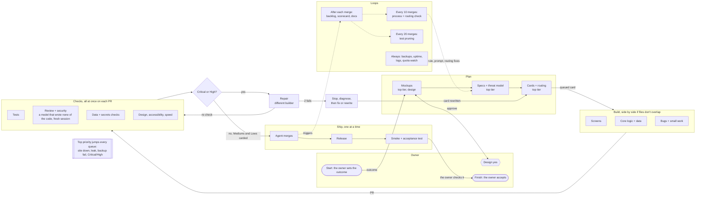

# Model routing

The one place for which model does what, how work flows, and what happens when a subscription runs out of quota. AGENTS.md points here. Model names live in this file and in the delivery agent's config, never in code. The Builds page reads this file (docs/delivery/builds-page.md), so a change here shows there with no code change.

Agreed with the owner on <DATE>.

Contents: 1. Process map · 2. Quota switching · 3. Main list · 4. Single-provider lists

**Filling this in.** The lists below name model slots, not models: `<TOP A>` is the top-tier model of provider A, `<MID B>` the mid-tier model of provider B, and so on. At setup, name each slot in the [Models](#models) table, name the providers and their soft limits in section 2, and write one single-provider list per provider in section 4. A slot a project doesn't have is replaced by the next tier up from the same provider, or removed with its backup moving up. Keep the builder pool in the projects config the same as the Models table, and change both in one change.

## 1. Process map

Work flows left to right. Dashed lines are loops that run after merges.

- Only Start, Design yes, Finish and top-priority items reach the owner. Everything else stays in Linear.
- A repair is always by a different builder, and a review is always by a model that wrote none of the PR's code. After 2 failed repairs, work stops and the cause is diagnosed (brief, environment, design reference or code) before anything is rebuilt, and a brief or code cause cancels the card and its PR (rule 3). A rebuild goes to the strongest model in the current list that has not worked on the card; if none is left, it needs the owner.
- Only Critical and High findings block a merge. Each Medium becomes a bug card for the mid-tier builder; each Low becomes a bug card in the Backlog.

## 2. Quota switching

Normal running uses the **main list** (section 3). When one of the owner's subscriptions runs out, every task switches to the first backup list, in the order <PROVIDER A>, <PROVIDER B>, <PROVIDER C>, whose provider still has quota. Put the provider with the most models first and the one with the fewest last. When the quota comes back, everything switches back to the main list.

**Out means** the provider reports no quota, the soft limit is reached, or the service is down (it can't start a card after one setup error or two timeouts). This is a break-glass switch for emergencies, not normal running. Soft limits (one line per provider; give the window it resets on):
- <PROVIDER A>: <SOFT LIMIT, e.g. past 85% of a short usage window; wait instead if it resets within an hour>. Use each window fully up to that line, and no further.
- <PROVIDER B>: <SOFT LIMIT, e.g. past 90% of the week with more than a day to reset>.
- <PROVIDER C>: <SOFT LIMIT, e.g. at 80% of the plan>.

| Who is out | Use this list |
|---|---|
| Nobody | Main list (section 3) |
| A | B only |
| B | A only |
| C | A only |
| A and B | C only |
| A and C | B only |
| B and C | A only |
| All three | Pause, with the handoff checkpoint kept |

**Switching rules:**
- Record when the provider ran out and the exact reset time the provider reports. Where a provider has both a short window and a weekly cap, use whichever reset it gives.
- Switch back to the main list as soon as the reset time passes, or the service is working again after an outage.
- A card that is already being built keeps its model, or pauses with the checkpoint. Only the next card uses the new list.
- Each list uses only its own provider's models. On every PR, the repairer is a different model from the builder, and the reviewer is a model that has written none of the PR's code: not the builder and not any repairer. So after a repair, the re-review goes to a third model. If the list has no such model left, carry on, mark the card, and a model that touched none of the code re-reviews it as soon as the main list is back, before any release that includes it.
- While on a backup list, Top and High priority cards go first. Other cards run when no Top or High card is waiting.
- Never Fast or Ultrafast, on any list.
- Nothing merges without tests and a review by a model that wrote none of the PR's code, whichever list is in use. The one exception is a single-provider list with no such model left: the PR merges with the card marked, and a model that touched none of the code re-reviews it before any release that includes it.
- Until the delivery agent can switch lists itself, the delivery owner switches by hand.

### Not enforced yet

Check what the delivery agent enforces before relying on a single-provider list. Its trusted receipts and its repair choice may expect a different model family, which would block or mis-route single-provider work. Until it handles them, the delivery owner runs single-provider mode by hand: it checks receipts against the exact PR head and records the exception on the card. List here each gap that is still open.

## How to read the lists

"Does it" is the model that does the task. "Backup" takes it when that one model fails to start. A backup never takes a task on a PR it wrote code or tests for; the next model on the list that wrote none of it takes it. A review is always done by a model that wrote none of the PR's code (not the builder, not any repairer), in a fresh session (rule 8).

**Parallel:** "Yes" runs alongside anything. "If files don't overlap" means two builds run side by side only when their cards name different repo paths. "One at a time" never runs beside another task of its kind.

**Automated:** "Auto" runs with nobody starting it. "Auto (to build)" is meant to be automatic but isn't built yet; it waits until the project's current product sections are done (rule 10), and the delivery owner does it by hand until then. "Delivery owner" means the delivery owner starts it and nothing waits on the owner. When the delivery owner's provider is out, the top-tier model of the list in use takes that role: it starts every "Delivery owner" task and does the hand switch; if it cannot, the item comes to the owner in chat as Top. "Owner's yes" needs the owner's approval (design, cost, data moves, privacy). "Auto, owner accepts" runs by itself and the owner checks the result (the Finish gate).

**Priority:** Top, High, Normal and Low map onto Linear priorities as Urgent, High, Medium and Low. "Top if it fails", "Top if down" and "Top if Critical" are Urgent in that case and the shown priority otherwise. "Top" never waits in a queue: it jumps ahead of everything, and if it can't be fixed straight away it comes to the owner in chat. Only Top items and decisions reach the owner; everything else stays in Linear.

## 3. Main list

### Design

| Task | What actually happens | Does it | Backup | Parallel | Automated | Priority |
|---|---|---|---|---|---|---|
| Mockups | Draw the screen as a working page with sample data, before anything is built | <TOP DESIGN> | <TOP A> | Yes | Owner's yes | High |
| Design system | Colours, type, spacing and parts reused across sections, so new screens match | <TOP DESIGN> | <TOP A> | Yes | Owner's yes | Normal |
| Screen layout for phone and desktop | Decide how each screen works at each width named on the card | <TOP A> | <TOP DESIGN> | Yes | Delivery owner | Normal |
| Design check | Compare built screens side by side with the mockup, list every difference | <TOP A> | <MID B> | Yes, on each PR | Auto (to build) | High |

### Planning and cards

| Task | What actually happens | Does it | Backup | Parallel | Automated | Priority |
|---|---|---|---|---|---|---|
| Specs | Write what a section must do, its data and its rules, from the owner's outcome | <TOP A> | <TOP DESIGN> | Yes | Delivery owner | High |
| Architecture | Decide how parts fit together: data model, services, where code lives | <TOP A> | <TOP B> | Yes | Delivery owner | High |
| Writing cards | Turn a spec into cards sized to one builder session each, with acceptance test, screen width, scope paths, builder and reviewer | <TOP A> | <MID A> | Yes | Delivery owner | High |
| Sizing and routing | Pick tier and builder for each card by its size and kind | <TOP A> | <MID A> | Yes | Auto (to build) | Normal |
| Backlog review | After every merge, re-order the backlog, drop stale cards, check the In Review limit | <MID A> | <TOP A> | After each merge | Auto | Normal |

### Building

| Task | What actually happens | Does it | Backup | Parallel | Automated | Priority |
|---|---|---|---|---|---|---|
| Screens and UX | Build pages and components to match the mockup | <TOP A> | <TOP DESIGN> | If files don't overlap | Auto | Normal |
| Cards that must match a mockup | First build of a mockup card (rule 2: strongest model first) | <TOP DESIGN> | <TOP A> | If files don't overlap | Auto | High |
| Core logic | The project's calculations and business rules | <TOP B> | <MID B> | If files don't overlap | Auto | High |
| Data and migrations | Database tables and changes; migration number given at merge (rule 5) | <TOP A> | <MID B> | One at a time | Auto | High |
| Imports and sync | Bringing outside data in, matching records | <TOP A> | <MID B> | If files don't overlap | Auto | High |
| Wide refactors | Changes that touch many files at once | <TOP A> | <MID B> | One at a time | Auto | Normal |
| Low and Medium bugs | Fix a logged bug with a clear cause | <MID A> | <MID B> | If files don't overlap | Auto | Normal |
| Clear small work | Bounded copy, layout or one-file changes | <MID C> | <MID A> | If files don't overlap | Auto | Low |
| Mechanical fixes | Renames, lint fixes, one-line changes | <LIGHT B> | <LIGHT A> | If files don't overlap | Auto | Low |
| Rewrite after 2 failed repairs | Stop and diagnose the cause (rule 3). Brief or code: cancel the card and its PR, then rewrite the card or rebuild from main. Environment: fix the setup and rerun the same head (not a repair round). Design reference: fix it on a new card (rule 13), or ask the owner | The strongest model in this list that has not worked on the card; if none is left, it needs the owner | <TOP DESIGN> | If files don't overlap | Auto (to build) | High |

### Repairs and merging

| Task | What actually happens | Does it | Backup | Parallel | Automated | Priority |
|---|---|---|---|---|---|---|
| Repairs | Fix Critical and High findings on a PR; never by the model that built it. After a repair, the re-review is by a model that wrote none of the code | A different builder: <MID B> repairs provider A's work, <TOP A> repairs provider B's work | <MID A> for provider B's work, <MID B> for provider A's work | Yes, on each PR | Auto | Top |
| Merge main into a PR | Bring a PR up to date and fix conflicts (the agent queues this itself, rule 4) | <MID B> | <MID A> | Yes, on each PR | Auto | High |
| Merging | Merge when the exact head has TESTS PASS and a review PASS | The delivery agent (no model) | None | One at a time | Auto | Top |

### Testing

| Task | What actually happens | Does it | Backup | Parallel | Automated | Priority |
|---|---|---|---|---|---|---|
| Test run on every PR | Run the scope set out in cursor-tests-prompt.md on the exact PR head and report TESTS PASS or TESTS FAIL; no run for docs only | <TESTER> | None. If its provider is out, switch lists (section 2); no second tester starts | Yes, on each PR | Auto | High |
| Writing tests | Add tests only for what the card changed | The card's builder | None | With the build | Auto | Normal |
| Acceptance test | Check the card's acceptance test passes on the running site, using the real screens | <MID B> | <MID A> | Yes | Auto, owner accepts | High |
| Smoke test script | Write and keep the script that checks the live site after a release (rule 9) | <MID A> | <MID B> | After each release | Auto (to build) | High |
| Flaky test fixes | Find why a test passes and fails at random and fix it; never by the model that wrote it | A different builder | <MID A> | If files don't overlap | Auto | High |

### Review

| Task | What actually happens | Does it | Backup | Parallel | Automated | Priority |
|---|---|---|---|---|---|---|
| Review of provider A's PRs | Read the change, rate findings Critical/High/Medium/Low, PASS or Changes required; the reviewer wrote none of the PR's code, builder or repairer | <TOP C> | <MID B> | Yes, on each PR | Auto | High |
| Review of provider B's PRs | Same, for provider B's work; if <TOP A> repaired it, <TOP C> re-reviews | <TOP A> | <TOP C> | Yes, on each PR | Auto | High |
| Review of provider C's PRs | Same, for provider C's work | <TOP A> | <MID A> | Yes, on each PR | Auto | High |
| Logging Mediums and Lows | Card each Medium for the mid-tier builder and each Low in the Backlog (rule 6) | The reviewer | None | Yes, on each PR | Auto (to build) | Low |

### DevOps

| Task | What actually happens | Does it | Backup | Parallel | Automated | Priority |
|---|---|---|---|---|---|---|
| Server setup | Create and size the server, install packages, set up users, services that start on boot, and swap | <TOP A> | <MID B> | One at a time | Owner's yes | Normal |
| Hosting and HTTPS | Web server config, domain names, getting and renewing HTTPS certificates, keeping private sites private and public sites public | <TOP A> | <MID A> | One at a time | Delivery owner | Normal |
| Private network | Join devices to the private network, set who can reach what, SSH over it, firewall rules | <TOP A> | <MID B> | One at a time | Delivery owner | Normal |
| Release scripts | Scripts that build the site, run migrations, restart services, health check, and roll back if the check fails | <TOP A> | <MID B> | If files don't overlap | Auto | Normal |
| Running releases | Run the release, check the site works, tell the owner what it does and doesn't include | <MID A> | <TOP A> | One at a time | Auto, owner accepts | High |
| Backups | Nightly database copy, offsite copy, how long copies are kept | <TOP A> | <MID B> | Yes | Auto | Top if it fails |
| Restore drills | Restore the latest backup into a spare database, compare counts with live, report | <MID A> | <LIGHT B> | Yes | Delivery owner | Normal |
| Data moves | Move data between machines: rehearsal first, compare copies, then switch over | <TOP A> | <MID B> | Alone, nothing else on the server | Owner's yes | Top |
| Logs and health | Read service logs, check disk and memory, spot stalls and out-of-memory, report problems | <LIGHT B> | <MID A> | Yes | Auto (to build) | Normal (Top if down) |
| Delivery agent upkeep | Update the agent, wait until idle before restart, change its config | <TOP A> | <MID B> | Alone, when the agent is idle | Delivery owner | High |
| Package updates | Update packages, run checks for what changed, keep the lock file right | <MID B> | <LIGHT B> | If files don't overlap | Auto | Low |
| Small config fixes | One-line config or script fixes with a clear cause | <MID C> | <LIGHT B> | If files don't overlap | Auto | Low |

### Security

| Task | What actually happens | Does it | Backup | Parallel | Automated | Priority |
|---|---|---|---|---|---|---|
| Security review of PRs | Check sign-in, input checks, database queries, forms and page output for holes; same reviewer split as Review, and the reviewer wrote none of the PR's code | The PR's reviewer | <MID A> | Yes, on each PR | Auto | High |
| Threat modelling | Before a new section is built: list its data, who can reach it, what could go wrong, what the card must guard against | <TOP A> | <TOP DESIGN> | Yes, before cards are written | Delivery owner | High |
| Secrets handling | Keep tokens and keys in owner-only files, never in git, cards, memory or logs; scan for leaks; renew tokens | <TOP A> | <MID B> | Yes, on each PR | Auto (to build) | Top |
| Access and permissions | What each person, builder and service can reach: SSH keys, network rules, token scopes, builder sandbox | <TOP A> | <MID B> | One at a time | Delivery owner | High |
| Package audit | Check packages for known security holes, rate each one, card the fixes | <MID B> | <LIGHT B> | Yes | Auto (to build) | Normal (Top if Critical) |
| Server hardening | Security updates, firewall, no password logins, block repeated failed logins | <TOP A> | <MID A> | One at a time | Delivery owner | High |
| Public site checks | HTTPS only, safe browser headers, no private data on public sites, sign-in on private ones | <MID B> | <MID A> | Yes | Auto (to build) | High |
| Backup safety | Backups encrypted, key stored safely, restore works without exposing data | <TOP A> | <MID B> | Yes | Delivery owner | High |
| If something leaks | Revoke and replace the leaked key, check logs for misuse, report to the owner | <TOP A> | <MID B> | Stops other work | Delivery owner | Top, tells the owner at once |

### Docs and reporting

| Task | What actually happens | Does it | Backup | Parallel | Automated | Priority |
|---|---|---|---|---|---|---|
| Repo docs | Keep README, AGENTS.md and decisions up to date with what changed | <MID A> | <TOP A> | With each PR | Auto | Low |
| Template sync | Copy workflow changes into the reusable project template, nothing project-specific | <TOP A> | <MID A> | Yes | Delivery owner | Normal |
| Scorecard | Each card's model and token cost on the Delivery scorecard (rule 12) | <LIGHT B> | <MID A> | Yes | Auto (to build) | Normal |
| Vendor cost check | Count plumbing cards per vendor, flag one that costs more than it saves (rule 11) | <MID A> | <TOP A> | Yes | Delivery owner | Normal |
| Model comparisons | Repair rates and cost per accepted card, by model | <TOP A> | <MID A> | Yes | Delivery owner | Normal |

### Quality, running and improving

| Task | What actually happens | Does it | Backup | Parallel | Automated | Priority |
|---|---|---|---|---|---|---|
| Bug triage | Read a bug the owner reports, rate it Critical/High/Medium/Low, set priority to match, write the card with acceptance test and screen width | <TOP A> | <MID A> | Yes | Delivery owner | High |
| Accessibility checks | Check keyboard use, colour contrast, text size and screen reader labels on changed screens | <MID B> | <MID A> | Yes, on each PR | Auto (to build) | Normal |
| Speed checks | Time page loads and database queries on changed screens, flag anything slow, card the fix | <MID A> | <MID B> | Yes, on each PR | Auto (to build) | Normal |
| Data checks | After a change, check totals and stored figures still match the source data | <TOP A> | <MID B> | Yes, on each PR | Auto (to build) | Top |
| Tidy-up | Remove dead code, old workarounds and unused files, with no change to behaviour | <TOP A> | <MID A> | If files don't overlap | Auto | Low |
| Privacy | Decide what personal data is kept, for how long, and who can see it; check new cards follow it | <TOP A> | <TOP DESIGN> | Yes | Owner's yes | High |
| Uptime alerts | Script that checks the site every few minutes and tells the owner when it is down | <MID A> | <LIGHT B> | Yes | Auto (to build) | Top |
| Quota watching | Check each provider's remaining quota, switch lists (section 2) before one runs out | <LIGHT B> | <MID A> | Yes | Auto (to build) | High |
| Release notes | Plain summary of what a release changes and doesn't include, for the owner | <MID A> | <LIGHT B> | With each release | Auto (to build) | Normal |
| Lessons learned | After a stall or miss, find the cause and fix the process in the rules and the template | <TOP A> | <MID A> | Yes | Delivery owner | High |

### Improving the process itself

| Task | What actually happens | Does it | Backup | Parallel | Automated | Priority |
|---|---|---|---|---|---|---|
| Process owner | Owns the whole loop and keeps making it better: reads every stall, miss and repair, and turns each into a rule, config or template fix | <TOP A> | <TOP DESIGN> | Yes | Delivery owner | High |
| Process health check | After every 10 merges: look at repair rounds, stalls, time per card and cost per accepted card by model, then propose changes | <TOP A> | <MID A> | After every 10 merges | Auto (to build) | High |
| Test size guard | Every review checks the PR's tests: only tests for what changed, no copies of existing tests, no giant test files. Test bloat is rated Medium and carded | The PR's reviewer | <MID B> | Yes, on each PR | Auto | Normal |
| Test pruning | After every 20 merges: find slow, duplicate and dead tests, remove or merge them, keep the test run time flat | <MID A> | <MID B> | If files don't overlap | Auto (to build) | Normal |
| Prompt quality | Keep builder briefs, reviewer and tester prompts and the card template short and clear; after any failed repair or miss, fix the prompt that let it through | <TOP A> | <TOP DESIGN> | Yes | Delivery owner | High |
| Model routing check | After every 10 merges: compare models on repair rate and cost, propose moving tasks in this list. The owner says yes before it changes | <TOP A> | <MID A> | After every 10 merges | Owner's yes | Normal |
| Rule changes | Any change to the owner's rules or this list is shown to the owner first, then recorded in AGENTS.md, decisions and the template | <TOP A> | <MID A> | Yes | Owner's yes | High |

The process owner is not the builder or reviewer of the same card, so it can judge the work fairly.

### Models

Name each slot here. Every slot used in the lists above has one row. Family is for information only: rule 8 needs a different model in a fresh session, whatever the vendor.

| Slot | Model | Provider | Tier | Best for |
|---|---|---|---|---|
| `<TOP DESIGN>` | <MODEL> | A | Top | Mockups, design system, first build of mockup cards |
| `<TOP A>` | <MODEL> | A | Top | Delivery owner: specs, architecture, cards, screens, wide refactors, data, server work, repairs of provider B's work, review of provider B's and C's work |
| `<MID A>` | <MODEL> | A | Mid | Low and Medium bugs, releases, restore drills, docs |
| `<LIGHT A>` | <MODEL> | A | Light | Simple mechanical jobs |
| `<TOP B>` | <MODEL> | B | Top | Core logic |
| `<MID B>` | <MODEL> | B | Mid | Backup for provider A's top-tier work, repairs of provider A's work, merge main, package updates, acceptance checks |
| `<LIGHT B>` | <MODEL> | B | Light | Cheap high-volume work: mechanical fixes, logs, scorecard rows. Not for reviews or long multi-step builds |
| `<TOP C>` | <MODEL> | C | Top | Review of provider A's work, including security review |
| `<MID C>` | <MODEL> | C | Mid | Clear small work, small config fixes |
| `<TESTER>` | <MODEL> | <PROVIDER> | Light | The test run on every PR |

Mark any tag that comes from a vendor's description rather than use in this project, and when it was looked up.

## 4. Single-provider lists

Write one list per provider: "<PROVIDER A> only", "<PROVIDER B> only", "<PROVIDER C> only". Each one has the same sections, tasks and columns as the main list, with every slot filled from that provider's models only, even where that is weaker. Each starts with a short "What changes with <PROVIDER> only" list that says, at least:

- Which model takes the work of each slot from another provider (for example, the top-tier model taking the core logic), and what that does to its plan limits.
- Where the test run goes when the tester's provider is out (for example, a mid-tier model in a cloud thread), and how long a run took when it was last done that way.
- That there is no other vendor to catch a blind spot shared by all of one provider's models. Rule 8 is still met, because the reviewer is a different model in a fresh session.
- Any task with no backup because the provider has too few models, and the reviewer exception from section 2 if the list can run out of models that wrote none of a PR's code.
- Who is delivery owner while the usual one is out: the top-tier model of the list in use.

Each list ends with a "Models in this setup" table: slot, model, tier, best for.
