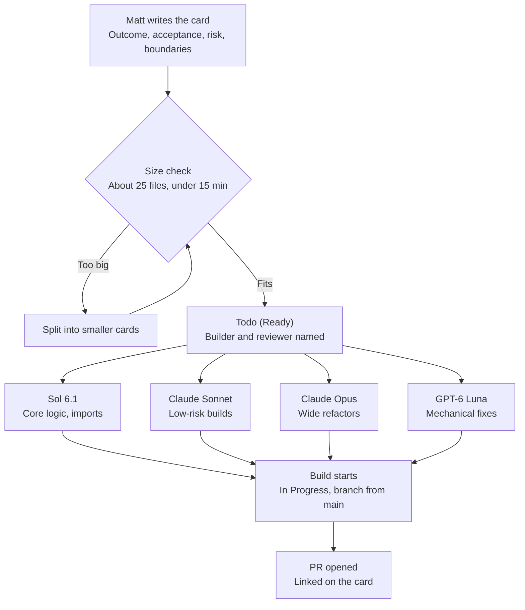
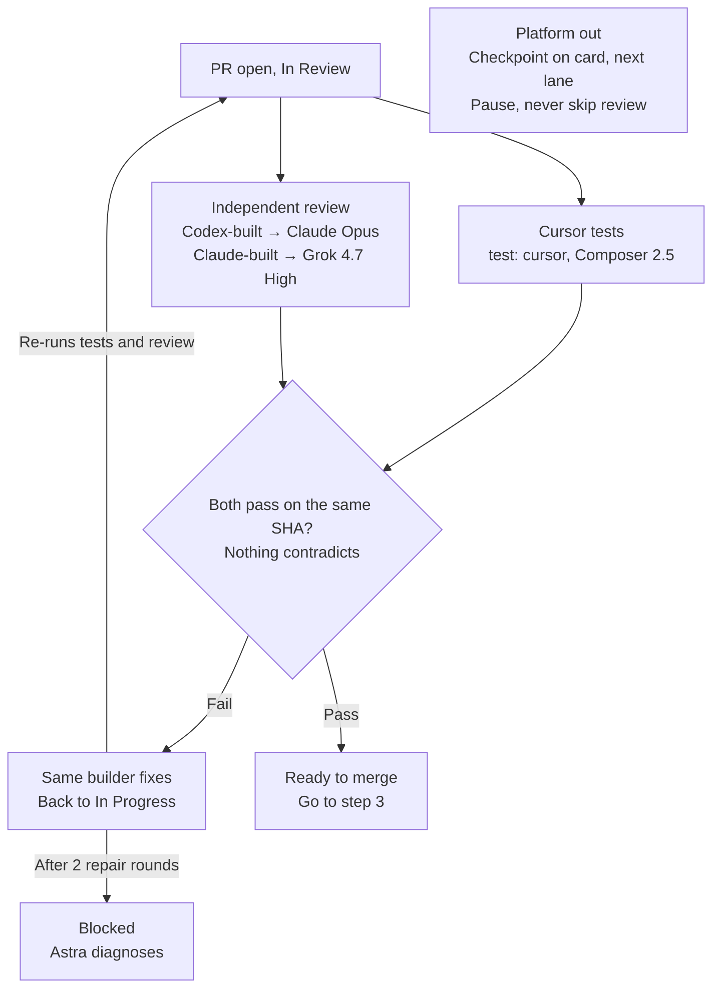
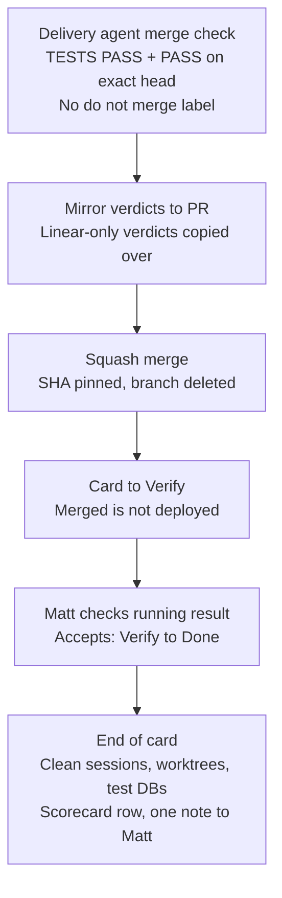

# Delivery workflow

The rules are in [AGENTS.md](../../AGENTS.md). This page draws them.

## 1. Card to pull request

## 2. Tests, review and repairs

## 3. Merge to Done

## Linear states

Backlog → Todo (Ready) → In Progress → In Review → In Review + `Verify` → Done
